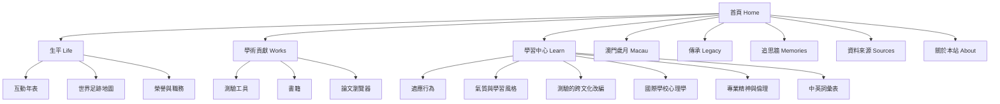
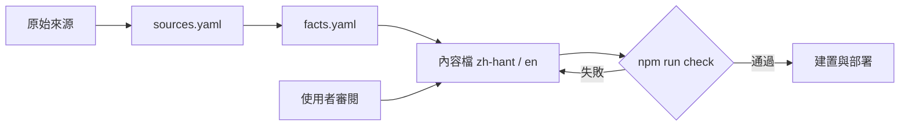
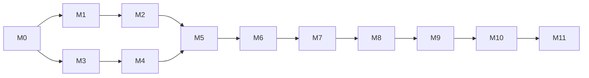

# Thomas D. Oakland 教授紀念網站 — Master Plan

> 版本：v2.0（2026-11-17）
> 本資料夾的文件是後續 session 的唯一依據。閱讀順序：
>
> 1. `MASTER_PLAN.md`（本文件）：目標、事實、架構、決策
> 2. `SONNET_PLAYBOOK.md`：執行手冊。每個任務的步驟和驗收標準
> 3. `DESIGN_SPEC.md`：視覺設計規格
> 4. `MACAU_STORY.md`：「澳門歲月」的素材（使用者親述）
> 5. `PROGRESS.md`：進度追蹤。每個 session 開始時先讀，結束時更新
> 6. `prototype/index.html`：視覺原型。用瀏覽器打開即可看

---

## 0. 給接手者的規則（必讀）

1. 用繁體中文回覆使用者。遵守 `CLAUDE.md`。
2. 一次只做一個任務。順序：定位 → 修改 → 驗證 → 下一項。
3. **不可憑記憶寫任何事實。** 每一項事實必須對應第 2 節的一個來源編號。
4. 狀態是 C 或 X 的事實，不可放上正式網站。
5. 兩個來源互相矛盾時，不可自行選擇。依第 2.5 節處理。
6. 不可重製有版權的測驗題目、常模表、手冊內文（第 6 節）。
7. 不可杜撰語錄、軼事、中文譯名。教授**沒有**中文名字。
8. 每一輪回覆的開頭都要有進度列（格式見 `SONNET_PLAYBOOK.md` 第 2 節）。
9. 每個 milestone 完成後，用「目前狀態／已完成／重要決策／限制／下一步」摘要，並更新 `PROGRESS.md`。
10. 小問題自己處理。符合 `SONNET_PLAYBOOK.md` 第 4 節的情況，才停下來請使用者轉 Opus。

---

## 1. 專案目標

| 項目 | 內容 |
|---|---|
| 目的 | 紀念 Thomas D. Oakland 教授，並向更多人介紹他和他的心理學貢獻 |
| 發起人 | 教授在澳門時的學生。網站署名發起人（Q7） |
| 語言 | 繁體中文、English。兩種語言內容對等 |
| 讀者 | ① 心理學與教育學學生 ② 學校心理學家與臨床工作者 ③ 教授的舊同事、學生、朋友 ④ 一般大眾 |
| 視覺 | 好看、專業、有現代感。安靜、莊重，不老派（見 `DESIGN_SPEC.md`） |
| 成功標準 | ① 所有事實可追溯到來源 ② 中英文頁面一一對應 ③ 訪客能在 10 分鐘內了解教授的三項主要貢獻 ④ 手機順暢 ⑤ Lighthouse 各項 ≥ 90 |
| 長期目標 | 程式做成**可重複使用的模板**。使用者之後會為其他已故的重要教授建立類似網站（Q1） |

---

## 2. 事實登記表（Fact Registry）

### 2.1 查證狀態

本規劃 session 的網路設定封鎖了下列網域，所以無法打開原文。表中事實來自搜尋引擎摘要。

- 被封鎖：`en.wikipedia.org`、`www.kenoshafuneralhome.com`、`education.ufl.edu`、`www.um.edu.mo`、`www.pearsonassessments.com`、`www.legacy.com`
- 執行 M1 前，使用者要在環境網路設定中開放這些網域。

| 狀態 | 意思 | 可否上線 |
|---|---|---|
| **V** | 已打開原文核對，內容一致 | 可 |
| **A** | 兩個以上獨立來源的搜尋摘要一致 | M1 核對原文後改為 V |
| **B** | 只有一個來源的搜尋摘要 | M1 核對原文後改為 V |
| **C** | 沒有來源 | 不可 |
| **X** | 來源互相矛盾 | 依 2.5 處理後才可 |
| **U** | 使用者親述 | 使用者確認最終文字後可 |

### 2.2 來源清單

| 編號 | 來源 | 網址 |
|---|---|---|
| S1 | Wikipedia: Thomas Oakland | https://en.wikipedia.org/wiki/Thomas_Oakland |
| S2 | Kenosha Funeral Home 訃聞（家屬版本） | https://www.kenoshafuneralhome.com/?p=15479 |
| S3 | UF College of Education 聲明（2015-03-09） | https://education.ufl.edu/news/2015/03/09/coe-responds-to-tragic-death-of-professor-emeritus-thomas-oakland/ |
| S4 | 澳門大學心理學系通訊 2010–2011（第 3 期） | https://www.um.edu.mo/fss/psychology/doc/DPSY%20Newsletter%203%20-%202010-2011.pdf |
| S5 | Jimerson, S. R. (2015). Thomas D. Oakland (1939–2015). *American Psychologist, 70*(6), 567. doi:10.1037/a0039485 | https://pubmed.ncbi.nlm.nih.gov/26348339/ |
| S6 | Fagan, T. (2015-09). Remembering Tom Oakland. NASP *Communiqué* | 尚未取得全文 |
| S7 | Pearson 作者頁 | https://www.pearsonassessments.com/professional-assessments/products/authors/oakland-thomas.html |
| S8 | Indiana University Honors & Awards | https://honorsandawards.iu.edu/awards/honoree/6344.html |
| S9 | WorldCat: ABAS-3 | https://search.worldcat.org/title/905907421 |
| S10 | Legacy.com 訃聞（Gainesville Sun） | https://www.legacy.com/us/obituaries/gainesville/name/thomas-oakland-obituary?id=9601699 |
| S11 | Nonpartisan Education Review 悼念文 | https://nonpartisaneducation.org/blog1/2015/03/tom-oakland-1939-2015/ |
| S12 | APA Division 16 *The School Psychologist* Fall 2015 | https://apadivision16.org/wp-content/uploads/2015/11/TSP-Fall-2015.pdf |
| S13 | 澳門大學心理學系通訊 2012–2013（第 5 期） | https://www.um.edu.mo/fss/psychology/doc/DPSY%20Newsletter%205%20-%202012-2013.pdf |
| S14 | Buros Center: Student Styles Questionnaire 測驗評論條目 | https://marketplace.unl.edu/buros/test-reviews/alphabetical-list/student-styles-questionnairetm.html |
| S15 | Texas A&M 圖書館目錄：*The Handbook of International School Psychology* | https://libcat.library.tamu.edu/Record/in00002207366 |
| S16 | UNSW 資源頁：ABAS-II | https://www2.psy.unsw.edu.au/users/smcdonald/Resources/Language%20and%20Communication/Adaptive%20Behavior%20Assessment%20System-II%20(ABAS-II).pdf |
| S17 | Texas Autism Network：ABAS-3 | https://www.txautism.net/evaluations/adaptive-behavior-assessment-system-third-edition |
| S18 | Wikidata: Thomas Oakland | https://www.wikidata.org/wiki/Q58894965 |
| UM | 使用者親述（見 `MACAU_STORY.md`） | — |

### 2.3 事實表：教授

| # | 事實 | 來源 | 狀態 |
|---|---|---|---|
| F1 | 全名 Thomas David Oakland。朋友稱他 Tom | S1, S2 | A |
| F2 | 1939-11-23 生於美國 Wisconsin 州 Kenosha | S1, S2, S10 | A |
| F3 | 2015-03-04 於 Florida 州 Gainesville 家中去世，享年 75 歲 | S1, S2, S3 | A |
| F4 | 大學就讀 Lawrence College；之後曾任中學教師 | S1, S2 | B |
| F5 | Indiana University 教育心理學 MS（1965）、PhD（1967） | S1, S8 | A |
| F6 | 在 University of Texas at Austin 教育心理學系任教 27 年 | S1, S2 | A |
| F7 | 到任 UT Austin：1967 或 1968；離任：1994 或 1995 | S1, S2 | **X** |
| F8 | 1995 年起任教 University of Florida，教授學校心理學 | S1, S3 | A |
| F9 | 退休：UF 聲明說 2010；家屬訃聞說 2013 年正式成為 Professor Emeritus | S3, S2 | **X** |
| F10 | 曾任 International School Psychology Association (ISPA) 會長 | S3 | B |
| F11 | 曾任 International Test Commission (ITC) 會長 | S3 | B |
| F12 | 曾任 International Foundation for Children's Education 會長 | S3 | B |
| F13 | Fulbright 學者，任職 University of Brasília | S2 | B |
| F14 | 曾任教 University of Hong Kong 心理學系 | S2 | B |
| F15 | 曾任教 Iberoamerican University（San José, Costa Rica） | S2 | B |
| F16 | 2010–2011 學年，澳門大學心理學系接待他作訪問學者，為期一個學期 | S4 | B |
| F17 | 工作足跡超過 40 個國家 | S2 | B |
| F18 | 12 本書、200 多篇章節與論文、11 套心理測驗（原文動詞要核對：authored 或 edited） | S1, S2 | B |
| F19 | 與 Patti Harrison 合著 Adaptive Behavior Assessment System（ABAS）。ABAS-3 於 2015 年由 Western Psychological Services 出版 | S9, S17 | A |
| F20 | ABAS-3 涵蓋概念、社會、實用三大領域，共 11 個技能範圍；適用年齡從出生到 89 歲 | S9, S17 | B |
| F21 | 1990 年 APA Division 16 Distinguished Service Award | S1 | B |
| F22 | 2000 年 APA Division 16 Senior Scientist Award | S1 | B |
| F23 | 2001 年 NASP Legends Award | S1 | B |
| F24 | 2003 年 Indiana University Distinguished Alumni Award | S1, S8 | A |
| F25 | 2003 年 APA 國際心理學傑出貢獻獎（正式獎名要核對） | S1 | B |
| F26 | 2004 年 UF Senior Faculty Distinguished International Educator of the Year | S1 | B |
| F27 | 兩名兒子：David Thomas Oakland（Houston）、Christopher Oakland（Austin）。**不在網站公開** | S2 | B |
| F28 | Oakland, T., Iliescu, D., Chen, H.-Y., & Chen, J. H. (2013)，三國適應行為比較，*Journal of Psychoeducational Assessment* | S13 | B |
| F29 | 在家中遇害。網站只用一句話說明（見 6.3） | S1, S3 | B |
| F30 | Oakland, T., Glutting, J. J., & Horton, C. B. (1996). *Student Styles Questionnaire*. The Psychological Corporation。用途：了解學生在偏好、氣質、個人風格上的個別差異 | S14 | B |
| F31a | ABAS-II 出版於 2003 年 | S16 | B |
| F31b | ABAS 第一版出版於 2000 年 | 無 | **C** |
| F32 | Jimerson, S. R., Oakland, T. D., & Farrell, P. T. (Eds.). (2007). *The Handbook of International School Psychology*. Sage. ISBN 9781412926690。收錄 43 個國家的作者 | S15 | A |
| F33 | 參與 ITC 測驗翻譯與改編準則 | 無 | **C** |
| F34 | ISPA、ITC 會長任期年份 | 無 | **C** |

### 2.4 事實表：澳門與發起人（使用者親述）

全部是狀態 **U**。詳細內容和待確認問題見 `MACAU_STORY.md`。

| # | 事實 |
|---|---|
| U1 | 教授在澳門大學臨床心理學碩士課程（Master of Clinical Psychology）教授認知評估（Cognitive Assessment）課；時間是 2010–2011 學年，即 S4 記載的那一個學期 |
| U2 | 教授和學生有私交，真心對待每一位同學，為大家的未來規劃提供想法 |
| U3 | 教授尊重每一個人，努力建造一個更好的世界 |
| U4 | 教授讓發起人明白：做事一定要專業，以及心理學家怎樣才算足夠專業 |
| U5 | 因為是教授的學生，發起人獲准到 University of South Florida（Tampa）旁聽學校心理學博士班課程，並和心理學系師生交流 |
| U6 | 教授影響發起人創立治療師公會，並成為臨床督導 |
| U7 | 教授離世後，發起人和幾位舊同學到美國出席喪禮，並和家屬一起整理遺物 |
| U8 | 發起人書架上保留從教授書房帶回的書和杯子 |
| U9 | 教授的離世促使發起人投入犯罪心理學研究、為更生人士提供服務、為警務人員提供犯罪心理學培訓 |

### 2.5 矛盾處理

| # | 處理方式 |
|---|---|
| F7 | M1 時打開 S1、S2、S5 原文。若仍不一致，網站寫「1967 年（一說 1968 年）」，並在來源頁說明 |
| F9 | 兩者可能都對：2010 年停止教學，2013 年正式取得榮休頭銜。M1 時核對原文。若原文支持此解釋，寫成「2010 年退休；2013 年獲授 Professor Emeritus」。否則照 F7 方式並列 |

### 2.6 尚需取得的資料

1. 完整著作目錄。來源：Google Scholar、APA PsycNet、WorldCat、Crossref、教授的 CV。
2. S5、S6、S12 的全文（同行悼念文，可信度最高）。
3. 11 套測驗的清單與出版資料。
4. 照片：使用者的私人合照（之後提供）。

---

## 3. 資訊架構



網址：`/zh-hant/...` 和 `/en/...`，結構相同。`/` 依瀏覽器語言導向，預設繁中。

| 頁面 | 內容 | 互動 |
|---|---|---|
| 首頁 | 肖像、一段簡介、數字列、三項貢獻、精選回憶、學習入口 | 語言切換；捲動進場 |
| 生平／年表 | 1939 → 2015 | 類別篩選；每項顯示來源 |
| 生平／地圖 | 工作過的國家與機構 | 可點擊 SVG 地圖。只標已查證地點 |
| 生平／榮譽 | 獎項、會長職務 | 卡片；依年份排序 |
| 學術貢獻／測驗 | 每套測驗：目的、對象、結構、出版資料、官方連結 | 結構圖（ABAS：3 領域、11 技能） |
| 學術貢獻／書籍 | 書目、自寫摘要 | 主題篩選 |
| 學術貢獻／論文 | 完整著作目錄 | 搜尋；依年份、主題篩選；DOI 連結 |
| 學習中心 | 5 個單元（第 4 節） | 圖解、自我檢核、延伸閱讀 |
| 詞彙表 | 中英對照與定義 | 內文詞彙可懸停／點擊看解釋 |
| 澳門歲月 | 教授在澳門的時期、發起人的回憶、照片 | 照片集；引言卡 |
| 傳承 | 教授的影響如何透過學生延續（U6、U9）。日後可收錄其他學生的故事 | 故事卡 |
| 追思牆 | 同事、學生的留言 | 外部表單投稿；人工審核 |
| 資料來源 | 所有來源；矛盾說明 | 每項事實可回連 |
| 關於本站 | 緣起、發起人署名、版權、更正管道 | 回報錯誤連結 |

---

## 4. 學習中心

每個單元結構相同：① 這是什麼 ② 為什麼重要 ③ 教授的貢獻 ④ 概念圖解 ⑤ 實務應用 ⑥ 自我檢核（3–5 題原創）⑦ 延伸閱讀。

| 單元 | 重點 | 依據 |
|---|---|---|
| T1 適應行為 | 定義；三大領域；與智能障礙診斷的關係；跨國比較 | F19、F20、F28 |
| T2 氣質與學習風格 | 學生的個別差異；如何依風格調整教學 | F30 |
| T3 測驗的跨文化改編 | 為何不能直接翻譯測驗；改編流程；公平性 | F11（F33 查證後再用） |
| T4 國際學校心理學 | 各國的發展；專業培訓 | F10、F32 |
| T5 專業精神與倫理 | 測驗使用倫理；「怎樣才算足夠專業」 | 先從著作目錄找教授的相關著作；可連結 U4 |

規則：

1. 內容是教授著作的摘要與導讀。用自己的文字寫。引用要標出處。
2. 每個單元至少依據兩篇教授的一手著作或權威二手來源。
3. 小測驗是理解題。不可使用或模仿任何測驗的題目。
4. 每頁加聲明：本站內容用於教育，不能取代專業評估。
5. **學習單元的學術內容由 Opus 撰寫或審閱**（見 `SONNET_PLAYBOOK.md` 第 4 節）。

---

## 5. 技術方案

| 項目 | 選擇 | 原因 |
|---|---|---|
| 框架 | Astro 5（靜態輸出） | 內容為主；內建 i18n；Content Collections 用 Zod schema 檢查資料 |
| 樣式 | 原生 CSS ＋ CSS 變數（設計 token 見 `DESIGN_SPEC.md`） | 原型已驗證；不需 Tailwind |
| 內容 | Markdown/MDX（長文）＋ YAML（事實、來源、年表、著作） | 內容和程式分離 |
| 互動 | Astro islands ＋ 原生 JS（必要時用 Preact） | 只在需要的地方載入 JS |
| 地圖 | 靜態 SVG 世界地圖＋資料驅動的標記 | 不依賴第三方地圖服務 |
| 搜尋 | Pagefind | 靜態、支援中文與多語言 |
| 字體 | Fontsource 自行託管：Newsreader、Inter、Noto Serif TC、Noto Sans TC（中文用子集化） | 不依賴 Google Fonts CDN；速度與隱私 |
| 追思投稿 | 外部表單（Google Forms 或 Tally）→ 人工審核 → 寫入 YAML | 沒有後端 |
| 部署 | GitHub Pages（GitHub Actions） | 免費；之後可加自訂網域（Q8） |
| 測試 | Playwright（截圖＋互動）、自寫資料檢查腳本、Lighthouse CI、axe | 見 5.3 |

### 5.1 Repo 與模板化（Q1）

1. 新 repo：`oakland-memorial`（由使用者在 GitHub 建立空 repo）。
2. 所有和教授有關的內容放在 `src/content/` 與 `site.config.ts`。元件、版面、檢查腳本不含任何教授的資料。
3. 完成後，把 repo 設為 GitHub **Template repository**。日後為其他教授建站：用模板建新 repo → 替換 `src/content/` 和 `site.config.ts`。
4. 本 repo `clinicmind/clinicmind` 只保留規劃文件。不改動根目錄的診所網站 `index.html`。

### 5.2 資料流程



### 5.3 自動檢查（`npm run check`，CI 必過）

1. **雙語對等**：每個 `zh-hant` 內容檔都有 `en` 對應檔，反之亦然。
2. **來源完整**：每筆年表、獎項、著作都有 `sourceIds`，且編號存在於 `sources.yaml`。
3. **狀態把關**：狀態 C、X 的事實不可被任何頁面引用。U 的事實要有 `approvedByUser: true`。
4. **禁用字**：內文不可出現教授的中文譯名（他沒有中文名字）。
5. **連結**：內部連結無斷鏈。
6. **無障礙**：axe 掃描沒有 serious／critical。
7. **型別**：`astro check` 無錯誤。

### 5.4 資料範例

```yaml
# src/content/facts/facts.yaml
- id: F5
  claim:
    en: "He received his MS (1965) and PhD (1967) in educational psychology from Indiana University."
    zh-hant: "他在 Indiana University 取得教育心理學碩士（1965）與博士（1967）學位。"
  sourceIds: [S1, S8]
  status: A          # V | A | B | C | X | U
  checkedOn: null    # 打開原文核對的日期，例如 2026-11-20
  approvedByUser: false  # 只有 U 需要
```

---

## 6. 版權、授權與敏感內容

### 6.1 測驗與著作

1. 不可刊登測驗題目、計分方法、常模、手冊內文。
2. 可以說明測驗的目的、對象、結構，並連到出版社官方頁面。
3. 論文只放書目、DOI、自寫摘要。不上傳 PDF（開放取用授權除外）。
4. 書籍封面圖片要確認授權；不確定就只用文字。

### 6.2 照片與回憶

1. 每張照片記錄：來源、拍攝者、授權狀態、照片中的人。沒有授權就不用。
2. 不可用 AI 生成或修改教授的肖像。
3. 照片中有其他人時，先取得當事人同意，或不放該照片。
4. 追思留言要有投稿者同意公開的紀錄。可匿名。
5. 發起人回憶中提到的其他同學，不寫名字，除非本人同意。

### 6.3 教授的離世（Q5：同意）

1. 生平頁只用一句話：他於 2015 年 3 月 4 日在 Gainesville 家中不幸離世。連到 UF 官方聲明。
2. 不刊登嫌疑人姓名、案件細節、新聞照片。
3. 「傳承」頁可以寫：這件事促使發起人投入犯罪心理學工作（U9）。重點放在延續，不放在案件。

### 6.4 家屬與 UF（Q6：同意，完成時提醒）

1. 網站在 M10 完成後，先部署到**不公開宣傳**的預覽網址。
2. Sonnet 必須提醒使用者：公開前聯絡家屬或 UF School Psychology Program。提醒文字已寫在 `SONNET_PLAYBOOK.md` 的 M11。
3. 網站上不列出家屬的個人資料。

---

## 7. Milestones 與時程

| # | Milestone | 主要產出 | 執行者 | 預估 |
|---|---|---|---|---|
| M0 | 環境準備 | 新 repo、網路網域、使用者答覆 Q9–Q12 | 使用者 | 使用者時間 |
| M1 | 事實查證 | 核對 S1–S18；更新狀態；處理 F7、F9 | Sonnet | 1 session |
| M2 | 著作目錄 | `works.yaml` | Sonnet | 1 session |
| M3 | 專案骨架＋檢查腳本 | Astro、i18n、CI、`npm run check` | Sonnet | 1 session |
| M4 | 設計系統 | token、字體、元件庫 | Sonnet | 1 session |
| M5 | 首頁＋生平區 | 首頁、年表、榮譽、地圖 | Sonnet | 1–2 session |
| M6 | 學術貢獻區 | 測驗、書籍、論文瀏覽器 | Sonnet | 1 session |
| M7 | 學習中心 | T1–T5、詞彙表 | **Opus 寫內容**，Sonnet 做頁面 | 2 session |
| M8 | 澳門歲月、傳承、追思牆 | 回憶、照片、投稿流程 | Sonnet（使用者審稿） | 1 session |
| M9 | 翻譯審校 | 全站中英審讀 | **Opus** | 1 session |
| M10 | 上線前檢查 | 無障礙、效能、SEO、預覽部署 | Sonnet | 1 session |
| M11 | 公開與模板化 | 聯絡家屬提醒；正式公開；設為模板 | Sonnet＋使用者 | 使用者時間 |

**總預估：約 11–13 個工作 session。** 若使用者每天開 1–2 個 session，並及時回覆審稿，約 **1.5–2 週**完成可預覽版本。正式公開日期取決於：網域開放、照片提供、家屬聯絡。



M1–M2（內容）和 M3–M4（技術）互不依賴。

---

## 8. 翻譯規則

1. 人名、機構名、測驗名、書名保留英文原文。
2. 教授一律稱 Thomas D. Oakland、Oakland 教授、Professor Oakland。
3. 專業詞彙採港澳臺心理學界通用譯法，全站統一，記錄在詞彙表：

| English | 繁體中文 |
|---|---|
| school psychology | 學校心理學 |
| adaptive behavior | 適應行為 |
| conceptual / social / practical domain | 概念／社會／實用領域 |
| temperament | 氣質 |
| test adaptation | 測驗改編 |
| psychological assessment | 心理評估 |
| cognitive assessment | 認知評估 |
| norm | 常模 |
| Professor Emeritus | 榮休教授 |
| clinical supervisor | 臨床督導 |
| rehabilitated offenders | 更生人士 |

4. 中英文各自自然通順，事實內容相同。不逐字翻譯。

---

## 9. 決策紀錄

| # | 問題 | 決定 |
|---|---|---|
| Q1 | 網站位置 | 新 repo `oakland-memorial`；做成可重用模板 |
| Q2 | 中文名字 | 沒有。全站用英文原名 |
| Q3 | 澳門回憶 | 已提供，見 `MACAU_STORY.md` |
| Q4 | 照片 | 有私人合照，之後提供 |
| Q5 | 離世寫法 | 同意 6.3 |
| Q6 | 聯絡家屬／UF | 同意。完成時提醒使用者 |
| Q7 | 署名 | 署名發起人：臨床心語（ClinicMind），臨床心理師（Q12） |
| Q8 | 自訂網域 | 之後再加 |

### 9.1 使用者答覆（2026-11-20）

| # | 問題 | 答覆 |
|---|---|---|
| Q9 | 旁聽博士班的學校 | University of South Florida（Tampa） |
| Q10 | 教授在澳門的時間 | 2010–2011 學年；學期即 S4 通訊所記載的那一個（使用者不記得是哪一學期，網站不寫學期） |
| Q11 | 課程 | 澳門大學 Master of Clinical Psychology；課程：Cognitive Assessment（認知評估） |
| Q12 | 署名 | 與診所網站相同：**臨床心語（ClinicMind）**，臨床心理師。治療師公會不寫正式名稱，只寫「一個治療師公會」 |
| Q13 | `MACAU_STORY.md` 草稿是否同意 | **尚未回覆。** M8 前再問；未同意前 U 內容不上線 |

網路：使用者已完全開放網路（P3 完成）。Repo 已建立：https://github.com/clinicmind/oakland-memorial（P1 完成）。P4（Pages 來源）待 M3 時確認。

---

## 10. 交接摘要

- **目前狀態**：規劃 v2 完成。視覺原型完成並通過桌面與手機截圖檢查。尚未建立網站程式。
- **已完成**：資訊架構、事實登記表 v2、技術方案、模板化設計、設計規格、原型、Sonnet 執行手冊、澳門素材草稿、時程。
- **重要決策**：① 事實必須有來源，由 `npm run check` 強制執行 ② 新 repo＋模板化 ③ 學習中心內容與翻譯審校交給 Opus ④ 離世只用一句話。
- **限制**：① 原文網頁尚未打開核對 ② F7、F9 矛盾 ③ F31b、F33、F34 沒有來源 ④ 沒有照片與著作目錄。
- **下一步**：使用者完成 `SONNET_PLAYBOOK.md` 第 1 節的準備工作 → 開 Sonnet session → M1。
