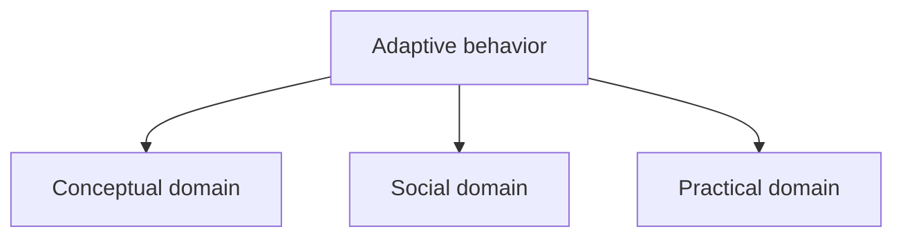

## What it is

Adaptive behavior is the collection of conceptual, social, and practical skills that people learn and use in everyday life [N-T1-1].

Think of daily tasks. A person reads a bus sign, greets a neighbor, and prepares a meal. Each task uses adaptive behavior.

Adaptive behavior is not the same as intelligence. Intellectual functioning refers to general mental capacity, such as learning, reasoning and problem solving. Adaptive behavior describes what a person actually does in daily life [N-T1-1].

## Why it matters

Psychologists use adaptive behavior information in the diagnosis of intellectual disability. One widely used definition says that intellectual disability involves significant limitations in both intellectual functioning and adaptive behavior, and that it begins before the age of 22 [N-T1-1].

A review of the field adds more reasons. It says adaptive behavior is important for understanding intellectual disability, for diagnosis, and for setting education and habilitation goals for a person [N-T1-2].

So an IQ score alone does not give the full picture. Adaptive behavior shows how a person manages in real settings.

## Professor Oakland's contribution

Professor Thomas D. Oakland developed tests in several areas. One area was adaptive behavior [N-T1-5].

Harrison and Oakland are the authors of the Adaptive Behavior Assessment System. The Second Edition (ABAS-II) appeared in 2003. The Third Edition (ABAS-3) appeared in 2015 and is published by Western Psychological Services.

He also studied how adaptive behavior measures work across cultures. In 2013, Oakland, Iliescu, Chen and Chen published a study on adaptive behavior in three countries. The article notes that such measures were typically built in Western cultures, yet people use them elsewhere [N-T1-3]. The authors describe how the ABAS-II Parent Form for ages 5 to 21 was adapted for Romania and Taiwan. They examined data from more than 3,000 parents and found considerable similarity across the three versions [N-T1-3].

This page describes his published work. It does not report his personal views.

## Key concepts

The ABAS-3 groups adaptive skills into three domains: Conceptual, Social and Practical. It has 11 adaptive skill areas and covers ages from birth through 89.

The AAIDD definition page describes the three domains as follows [N-T1-1]:

1. The conceptual domain covers skills such as language, literacy, and the concepts of money, time and number.
2. The social domain covers skills such as interpersonal skills and following rules.
3. The practical domain covers skills such as personal care, work, health care and safety.

Two more ideas help.

- **Rating format.** Others who know the person provide the information. For children, this can be parents or teachers. For adults, it can be family, care providers, supervisors, or the person himself or herself [N-T1-4].
- **Cultural transport.** A test built in one culture may need careful translation and adaptation before use in another [N-T1-3].

## In practice

Practitioners use adaptive behavior assessment for several purposes. A source on the ABAS-3 lists these uses [N-T1-4]:

1. Develop treatment plans and training goals.
2. Document and monitor progress over time.
3. Determine eligibility for services, such as disability benefits.
4. Evaluate the ability to live and work independently.

Because the ABAS-3 uses ratings from people who know the person, families and teachers play a direct role. They describe what the person does day to day [N-T1-4].

## Self-check

1. Which statement describes adaptive behavior best?

   A. The score a person gets on an IQ test.
   B. The conceptual, social and practical skills a person learns and uses in daily life.
   C. A person's temperament at school.
   D. The number of years a person spent in school.

   **Answer:** B. Adaptive behavior is the collection of conceptual, social and practical skills used in everyday life.

2. Which three domains does the ABAS-3 use?

   A. Verbal, Visual and Motor.
   B. Academic, Medical and Legal.
   C. Conceptual, Social and Practical.
   D. Home, School and Work.

   **Answer:** C. The ABAS-3 groups adaptive skills into the Conceptual, Social and Practical domains.

3. Why does adaptive behavior matter in the diagnosis of intellectual disability?

   A. The definition names significant limitations in both intellectual functioning and adaptive behavior.
   B. Adaptive behavior replaces the need to consider intellectual functioning.
   C. It only applies to adults.
   D. It is used only for research.

   **Answer:** A. The definition requires limitations in both areas, so adaptive behavior is one of two required parts.

4. What did the 2013 study by Oakland, Iliescu, Chen and Chen examine?

   A. How the ABAS-II Parent Form was adapted and compared across the United States, Romania and Taiwan.
   B. How to teach reading to young children.
   C. A new method to score IQ tests.
   D. How teachers choose textbooks.

   **Answer:** A. The study describes the Romanian and Taiwan adaptation of the ABAS-II Parent Form and compares data across three versions.

5. Who can provide ratings for an adult on the ABAS-3?

   A. Only a physician.
   B. Only a court.
   C. Only the person's employer.
   D. Significant others, care providers, supervisors, or the person himself or herself.

   **Answer:** D. The ABAS-3 source lists these people as possible informants for adults.

## Further reading

- Oakland, T., Iliescu, D., Chen, H.-Y., & Chen, J. H. (2013). Cross-national assessment of adaptive behavior in three countries. *Journal of Psychoeducational Assessment, 31*(5), 435-447. https://doi.org/10.1177/0734282912469492
- Oakland, T., & Daley, M. (2013). Adaptive behavior: Its history, concepts, assessment, and applications. In *APA handbook of testing and assessment in psychology: Vol. 3. Testing and assessment in school psychology and education* (pp. 183-212). American Psychological Association. https://doi.org/10.1037/14049-009
- Kane, H., & Oakland, T. D. (2014). The differentiation of adaptive behaviours: Evidence from high and low performers. *Educational Psychology, 35*(6), 675-688. https://doi.org/10.1080/01443410.2014.893558
- Tassé, M. J., Schalock, R. L., Balboni, G., Bersani, H., Borthwick-Duffy, S. A., Spreat, S., Thissen, D., Widaman, K. F., & Zhang, D. (2012). The construct of adaptive behavior: Its conceptualization, measurement, and use in the field of intellectual disability. *American Journal on Intellectual and Developmental Disabilities, 117*(4), 291-303. https://doi.org/10.1352/1944-7558-117.4.291
- Harrison, P. L., & Oakland, T. (2015). *Adaptive Behavior Assessment System, Third Edition*. Western Psychological Services.

*This page is educational content. It is not a substitute for professional assessment.*
