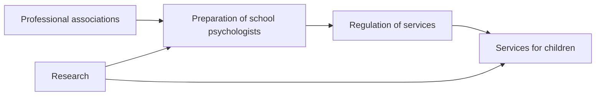

## What it is

International school psychology studies how school psychology works in different countries. It asks who school psychologists are, how they train, and how their services are regulated. It also looks at how professionals in different countries cooperate.

The International School Psychology Association (ISPA) is one place where this cooperation happens. Its website says a group of school psychologists formed an International School Psychology Committee in the early 1970s. The committee aimed to promote worldwide cooperation among school and educational psychologists. ISPA was founded in 1982 with Anders Poulsen as its first President [N-T4-1].

## Why it matters

Children go to school in every country. Their school psychologists work under different laws, funding and training systems. A comparison across countries helps each country see its own system more clearly. It also helps new programs learn from older ones.

A 1992 survey of school psychology in developed and developing countries shows this. Its authors found that similar ideas about the roles and functions of school psychologists exist throughout the world. They also found that expectations for more professionalism were higher in the more developed countries [N-T4-2].

## Professor Oakland's contribution

1. **ISPA leadership.** Professor Oakland served as president of ISPA. A tribute in *The School Psychologist* says he held the presidency from 1995 to 1997 [S12].
2. **A handbook.** Jimerson, Oakland and Farrell edited *The Handbook of International School Psychology* (SAGE, 2007) [S19].
3. **International research.** Oakland and Cunningham (1992) asked professionals with expertise in school psychology about its status in developed and developing countries. The survey covered six issues: functions, characteristics, preparation, regulation of services, the importance of research, and predicted future trends [N-T4-2].
4. **Priorities for the field.** In the same special issue, Oakland summarised points that other authors made in response to the survey data. The major themes include a balance between professional uniformity and diversity, a strong commitment to research, and strong professional associations at national and international levels. They also include an international institute on school psychology and further international studies [N-T4-3].
5. **A history.** Oakland (1993) wrote *A brief history of international school psychology*. See Further reading.
6. **Professional preparation.** In 2014, Oakland and Hatzichristou summarised information on preparation programs from several countries. They wrote that stronger leadership from national, regional and international associations is needed to counterbalance the effects of external control on the specialty [N-T4-4]. Oakland's epilogue to the same special issue named five issues to consider if ISPA reviews its preparation guidelines [N-T4-5].

## Key concepts

- **Regulation.** The 1992 survey reports that universities, federal agencies and professional associations of psychology and education regulate school psychology [N-T4-2].
- **Preparation.** This means how a country trains its school psychologists. It is one of the six issues in the survey [N-T4-2].
- **Uniformity and diversity.** A field needs shared standards. It also needs room for local needs. Oakland (1992) names this balance as a major theme [N-T4-3].
- **Professional associations.** National and international associations support the field and its training [N-T4-3] [N-T4-4].

## In practice

These ideas help students, trainers and school psychologists.

1. Compare your own training route with that of another country. Ask who regulates the profession in each place.
2. When you read a study from another country, ask how local laws, funding and culture shape the services.
3. Look for both shared roles and local differences. The 1992 survey reports shared ideas about roles, and it also reports substantial differences between high-GNP and low-GNP countries [N-T4-2].
4. Join or follow professional associations. They offer training, resources and contact with colleagues abroad.

## Self-check

1. Which statement matches the 1992 survey on the roles and functions of school psychologists?
   - A. Each country holds a very different view.
   - B. Similar views exist throughout the world.
   - C. Only developed countries define these roles.
   - D. The roles are the same as those of teachers.

   **Answer:** B. The survey abstract says similar conceptions of the roles and functions are held throughout the world.

2. According to the survey, where were expectations for more professionalism higher?
   - A. In the more developed countries.
   - B. In the less developed countries.
   - C. In countries without universities.
   - D. In countries without associations.

   **Answer:** A. The abstract reports higher expectations in the more developed countries.

3. Which theme appears in Oakland's 1992 discussion of priorities?
   - A. Remove all research from training.
   - B. Use one fixed model in every country.
   - C. Balance professional uniformity and diversity.
   - D. End all national associations.

   **Answer:** C. The article lists this balance as a major theme.

4. For which years does the tribute in *The School Psychologist* give Professor Oakland's ISPA presidency?
   - A. 1982 to 1984.
   - B. 1990 to 1992.
   - C. 1995 to 1997.
   - D. 2005 to 2007.

   **Answer:** C. The tribute states 1995 to 1997.

## Further reading

- Jimerson, S. R., Oakland, T. D., & Farrell, P. T. (Eds.). (2007). *The handbook of international school psychology*. SAGE Publications. https://doi.org/10.4135/9781412976138
- Oakland, T. (1993). A brief history of international school psychology. *Journal of School Psychology, 31*(1), 109-122. https://doi.org/10.1016/0022-4405(93)90024-d
- Oakland, T. D. (1992). Formulating priorities for international school psychology toward the turn of the twentieth century. *School Psychology International, 13*(2), 171-177. https://doi.org/10.1177/0143034392132008
- Oakland, T. D., & Cunningham, J. L. (1992). A survey of school psychology in developed and developing countries. *School Psychology International, 13*(2), 99-129. https://doi.org/10.1177/0143034392132001
- Oakland, T. (2014). An epilogue: Issues and implications for incorporating multicultural issues in the International School Psychology Association's professional preparation guidelines. *International Journal of School & Educational Psychology, 2*(3), 231-234. https://doi.org/10.1080/21683603.2014.934614
- Oakland, T., & Hatzichristou, C. (2014). Professional preparation in school psychology: A summary of information from programs in seven countries. *International Journal of School & Educational Psychology, 2*(3), 223-230. https://doi.org/10.1080/21683603.2014.934638

*This page is educational content. It is not a substitute for professional advice.*
