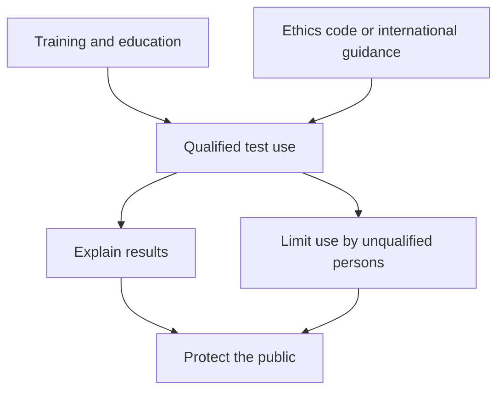

## What it is

Professional ethics in assessment covers how psychologists and other professionals use tests with care. An ethics code states the behaviors a profession expects. Leach and Oakland describe such codes as designed to protect the public by prescribing the behaviors professionals are expected to exhibit [N-T5-3].

Professionalism is a wider idea. It includes training, standards of practice and the duties a profession accepts. This unit looks at both. It uses only Professor Oakland's published work.

## Why it matters

Many professionals use tests with children and youth. A survey of professional groups found that those most likely to employ tests include school or educational psychologists, teachers, counselors, and clinical and general psychologists [N-T5-1]. Each group needs clear standards.

Ethics codes do not exist everywhere. A review of codes from national psychological associations found that codes from about one third of the countries surveyed do not address test use [N-T5-3]. A psychologist may therefore work where no written rule applies. Oakland's later work with Leach addressed this problem [N-T5-4].

## Professor Oakland's contribution

1. **Professionalism in school psychology.** In 1986, Oakland published two papers in *Professional School Psychology*: "Professionalism within school psychology" and "Further thoughts on professionalism in school psychology." See Further reading.
2. **Who uses tests, and how they learn.** Oakland and Hu (1991) reviewed the professional groups that use tests in an international survey. They reported that most professionals learn tests through coursework. They also reported that perceived adequacy in test use correlates with years of post-secondary education [N-T5-1].
3. **A code of ethics for an international association.** Oakland, Goldman and Bischoff published the *Code of Ethics of the International School Psychology Association* in 1997. ISPA's Standards and Practices Committee prepared the code, and ISPA's General Assembly approved it in August 1990. It addresses professional responsibilities, confidentiality, professional growth, professional limitations, professional relationships, assessment and research [N-T5-2].
4. **Test use in school psychology.** Oakland (1997) reviewed current test use with children and youth, mainly by school or educational psychologists. He discussed the status of the specialty, traditional purposes and common problems of test use, and emerging trends [N-T5-5].
5. **Ethics codes across countries.** Leach and Oakland (2007) compared testing standards in ethics codes from many countries with those in the 2002 APA code. Standards that require psychologists to explain results, use tests properly, and limit their use by unqualified persons were the most frequent. Standards on test construction, and standards that restrict obsolete tests, were rare [N-T5-3].
6. **Unclear standards.** Leach and Oakland (2010) wrote about psychologists who work in countries without an ethics code. They highlighted conditions to know about: the host country's moral values, its laws and administrative policies, and ethics codes and policies of international agencies and associations. They also gave eight guidelines [N-T5-4].
7. **Training guidelines.** In a 2014 epilogue, Oakland named five issues to consider if ISPA reviews its preparation guidelines [N-T4-5].

## Key concepts

- **Ethics code.** A written set of expected behaviors that protects the public [N-T5-3].
- **Qualified use.** Codes often ask psychologists to limit test use by unqualified persons [N-T5-3].
- **Explaining results.** Codes often ask psychologists to explain results [N-T5-3].
- **Training and adequacy.** In the 1991 survey, more years of post-secondary education went with higher perceived adequacy in test use [N-T5-1].
- **Host-country context.** Where no code exists, a psychologist considers local values, laws, policies and international guidance [N-T5-4].

## In practice

These questions come from the research above. They do not replace the code that applies to you.

1. Which ethics code governs my work? If none exists, what do local laws, policies and international guidance say [N-T5-4]?
2. Have I trained for the assessment I plan to carry out?
3. Can I explain the results in plain words to the people who need them [N-T5-3]?
4. Who else can reach the test materials? Do I need to limit their use to qualified persons [N-T5-3]?
5. Is the test still current? Leach and Oakland found that standards on obsolete tests are rare, so check this yourself [N-T5-3].

## Self-check

1. In the review of ethics codes by Leach and Oakland (2007), which kind of standard appeared most often?
   - A. Standards on the design of new tests.
   - B. Standards that require explaining results.
   - C. Standards on the price of tests.
   - D. Standards that ban all test use.

   **Answer:** B. The abstract lists explaining results, proper test use and limiting use by unqualified persons as the most frequent.

2. What did the 1991 survey find about how most professionals learn tests?
   - A. Mostly through coursework.
   - B. Mostly through newspapers.
   - C. Mostly through test publishers only.
   - D. Mostly by trial and error.

   **Answer:** A. The abstract says most professionals learn tests through coursework.

3. A psychologist moves to a country with no ethics code. What do Leach and Oakland (2010) advise the psychologist to know?
   - A. Only the rules of the home country.
   - B. Nothing, because no rules apply.
   - C. The host country's moral values, laws and policies, and international codes and policies.
   - D. Only the rules of the largest test publisher.

   **Answer:** C. The abstract names these conditions.

4. Which body prepared the *Code of Ethics of the International School Psychology Association*?
   - A. The Standards and Practices Committee of ISPA.
   - B. A national ministry of education.
   - C. A test publisher.
   - D. A university department.

   **Answer:** A. The abstract states that the Standards and Practices Committee prepared it.

## Further reading

- Leach, M. M., & Oakland, T. (2007). Ethics standards impacting test development and use: A review of 31 ethics codes impacting practices in 35 countries. *International Journal of Testing, 7*(1), 71-88. https://doi.org/10.1080/15305050709336859
- Leach, M. M., & Oakland, T. (2010). Displaying ethical behaviors by psychologists when standards are unclear. *Ethics & Behavior, 20*(3-4), 197-206. https://doi.org/10.1080/10508421003798893
- Oakland, T. (1997). Test use among school psychologists: Past, current, and emerging practices. *European Journal of Psychological Assessment, 13*(1), 2-9. https://doi.org/10.1027/1015-5759.13.1.2
- Oakland, T., & Hu, S. (1991). Professionals who administer tests with children and youth: An international survey. *Journal of Psychoeducational Assessment, 9*(2), 108-120. https://doi.org/10.1177/073428299100900201
- Oakland, T., Goldman, S., & Bischoff, H. (1997). Code of ethics of the International School Psychology Association. *School Psychology International, 18*(4), 291-298. https://doi.org/10.1177/0143034397184001
- Oakland, T. D. (1986). Professionalism within school psychology. *Professional School Psychology, 1*(1), 9-27. https://doi.org/10.1037/h0090496
- Oakland, T. D. (1986). Further thoughts on professionalism in school psychology. *Professional School Psychology, 1*(1), 47-49. https://doi.org/10.1037/h0090495

*This page is educational content. It is not a substitute for professional advice.*
