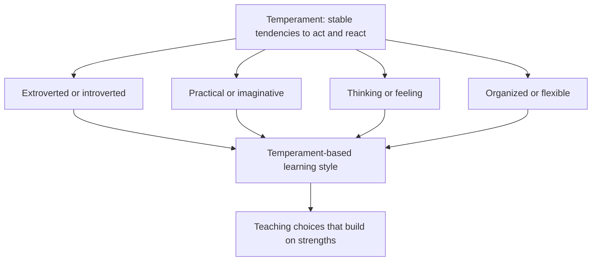

## What it is

Temperament describes how a person tends to act and react. Scholars usually describe it as stylistic and relatively stable. It covers intrinsic tendencies to respond in fairly predictable ways to people, events and other stimuli [N-T2-8].

A learning style links those tendencies to school. Oakland and Joyce (2004) describe how temperament styles influence teaching and learning styles [N-T2-2].

Oakland and colleagues describe children aged 8-17 with eight basic styles. The eight styles form four pairs [N-T2-3]:

1. Extroverted or introverted.
2. Practical or imaginative.
3. Thinking or feeling.
4. Organized or flexible.

The pairs describe preferences [N-T2-1].

## Why it matters

Knowing a child's temperament helps adults understand where behaviors come from. It also helps them understand ordinary attitudes children show at home and at school [N-T2-8].

Teachers can use this knowledge. Oakland and Joyce (2004) encourage teachers to give students chances to use their strengths and to overcome weaknesses. They also encourage teachers to promote positive behaviors, to help students understand themselves and others, and to identify vocational interests [N-T2-2].

## Professor Oakland's contribution

Oakland, Horton and Glutting published the Student Styles Questionnaire (SSQ) in 1996. The Buros Center for Testing quotes its purpose: it is "designed to detect individual differences students display in their preferences, temperaments, and personal styles" [N-T2-1].

Research on the SSQ built the evidence base around it. Four examples follow.

1. **Theory.** The SSQ rests on Jung's theory of temperament, as augmented by Myers and Briggs [N-T2-4].
2. **Fairness across groups in one country.** Stafford and Oakland (1996) studied African American, Hispanic American and Anglo American students. They report a high degree of factor similarity across the three groups. They also report that the pattern was less strong when Hispanic Americans from New York and from Texas were compared [N-T2-6]. Item-level differences appeared on 25% of items when African American and Anglo American students were compared [N-T2-9].
3. **Fairness across countries.** Benson, Oakland and Shermis (2008) tested a four-pair model. It fit Australian, Chinese, Costa Rican, Philippine, United States and Zimbabwean samples very well. It fit Gaza (Palestinian) and Nigerian samples only modestly. The authors call this partial support for the idea that the structure transcends differences in language and culture [N-T2-4].
4. **Group comparisons.** In a study of identified gifted and nongifted students, the two groups did not differ much on three of the pairs. Gifted students showed a stronger preference for imaginative styles. Nongifted students showed a stronger preference for practical styles [N-T2-5]. In a China and United States comparison, Chinese children were more likely to prefer practical, thinking and organized styles. The authors say this may reflect values in a collectivist or an individualist society [N-T2-7].

## Key concepts

- **Temperament.** Stylistic, relatively stable tendencies to act and react [N-T2-8].
- **Bipolar style pair.** Two opposite styles on one continuum. Four pairs make up the model [N-T2-3].
- **Preference, not ability.** The SSQ looks at preferences, temperaments and personal styles [N-T2-1].
- **Invariance.** A test shows invariance across countries when its scores mean the same thing in each country. Benson, Oakland and Shermis (2008) test this idea for the SSQ [N-T2-4].
- **Group difference, not individual rule.** A gap between two groups tells you about groups. It does not tell you how one child will behave [N-T2-5].

## In practice

1. **Start with strengths.** Offer ways for students to use their strengths. Then support the areas where they struggle [N-T2-2].
2. **Talk about differences.** Help students understand themselves and others. Oakland and Joyce (2004) list this as a goal for teachers [N-T2-2].
3. **Look beyond the classroom.** Style information can also point to vocational interests [N-T2-2].
4. **Respect the child's age range.** The SSQ is a temperament measure for students aged 8 through 17 [N-T2-6].
5. **Use tests through qualified professionals.** This site does not reproduce items, scoring or norms. The publisher holds those. See the SSQ overview page on this site.
6. **Check culture before comparing.** Results from one country do not automatically carry to another. The cross-national evidence is strong for some samples and weaker for others [N-T2-4].

## Self-check

1. In the Oakland model for ages 8-17, how many bipolar pairs describe temperament?

   A. Two
   B. Four
   C. Eight
   D. Sixteen

   **Answer:** B. The eight basic styles are grouped into four bipolar pairs [N-T2-3].

2. A teacher learns that gifted students on average prefer imaginative styles more than nongifted students do. What is the best conclusion?

   A. Every gifted student prefers imaginative styles.
   B. Imaginative styles cause giftedness.
   C. The result describes groups, so each student still needs individual attention.
   D. Practical styles are a weakness.

   **Answer:** C. A group difference does not predict one child's style [N-T2-5].

3. Which statement best describes what the SSQ looks at?

   A. Intelligence quotient
   B. Preferences, temperaments and personal styles
   C. Reading level
   D. Adaptive behavior in daily life

   **Answer:** B. The Buros entry states this purpose [N-T2-1].

4. Why do researchers test a temperament measure in several countries?

   A. To check that the scores mean the same thing across cultures.
   B. To make the test shorter.
   C. To avoid the need for validity evidence.
   D. To rank countries from best to worst.

   **Answer:** A. This is the question of cross-national invariance, which Benson, Oakland and Shermis (2008) examine [N-T2-4].

## Further reading

- Benson, N., Oakland, T., & Shermis, M. (2008). Cross-national invariance of children's temperament. *Journal of Psychoeducational Assessment, 27*(1), 3-16. https://doi.org/10.1177/0734282908318563
- Calluen, C., & Oakland, T. (2014). If you do not know the child's temperament you do not know the child. *Estudos de Psicologia (Campinas), 31*(1), 3-14. https://doi.org/10.1590/0103-166x2014000100001
- Oakland, T., & Joyce, D. (2004). Temperament-based learning styles and school-based applications. *Canadian Journal of School Psychology, 19*(1-2), 59-74. https://doi.org/10.1177/082957350401900103
- Oakland, T., Joyce, D. D., Horton, C., & Glutting, J. (2000). Temperament-based learning styles of identified gifted and nongifted students. *Gifted Child Quarterly, 44*(3), 183-189. https://doi.org/10.1177/001698620004400304
- Stafford, M. E., & Oakland, T. D. (1996). Validity of temperament constructs using the Student Styles Questionnaire: Comparisons for three racial-ethnic groups. *Journal of Psychoeducational Assessment, 14*(2), 109-120. https://doi.org/10.1177/073428299601400202

*This page is educational content. It does not replace a professional assessment.*
