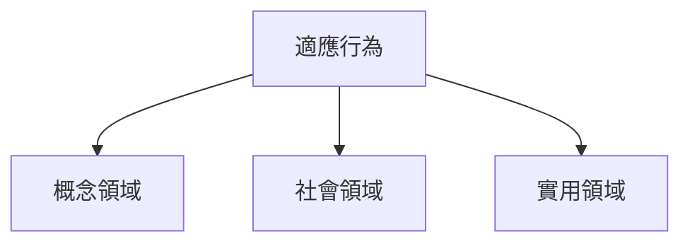

## 這是什麼

適應行為是一組概念、社會與實用技能。人在日常生活中學會這些技能，並加以運用 [N-T1-1]。

想想日常的事：看懂巴士站牌、向鄰居打招呼、準備一頓飯。這些事都用到適應行為。

適應行為不等於智力。智力功能指一般的心智能力，例如學習、推理與解決問題。適應行為則描述一個人在日常生活中實際做得到什麼 [N-T1-1]。

## 為什麼重要

心理學家在診斷智能障礙時，會使用適應行為的資料。一個廣被使用的定義指出：智能障礙是智力功能與適應行為兩方面都有顯著限制，而且在 22 歲之前出現 [N-T1-1]。

一篇領域回顧再補充了幾個理由。文章指出，適應行為有助於理解智能障礙、進行診斷，以及為個人訂定教育與復康（habilitation）目標 [N-T1-2]。

所以，只看智商分數，並不能看到全貌。適應行為顯示一個人在真實情境中如何生活。

## Oakland 教授的貢獻

Thomas D. Oakland 教授編製過多方面的測驗，其中一個領域是適應行為 [N-T1-5]。

《適應行為評量系統》（Adaptive Behavior Assessment System）的作者是 Harrison 與 Oakland。第二版（ABAS-II）於 2003 年出版。第三版（ABAS-3）於 2015 年出版，由 Western Psychological Services 發行。

他也研究適應行為量表在不同文化中的運作。2013 年，Oakland、Iliescu、Chen 與 Chen 發表了一項涵蓋三個國家的適應行為研究。文章指出，這類量表多半在西方文化中編製，但世界各地仍在使用 [N-T1-3]。作者說明了 ABAS-II 家長版（5 至 21 歲）如何改編成羅馬尼亞版與臺灣版。他們分析了三千多位家長的資料，發現三個版本之間有相當高的相似性 [N-T1-3]。

本頁只描述他發表的工作，不呈現他個人的看法。

## 核心概念

ABAS-3 把適應技能分成三大領域：概念、社會、實用。它有 11 個適應技能範圍，適用年齡從出生到 89 歲。

AAIDD 的定義頁這樣描述三個領域 [N-T1-1]：

1. 概念領域包括語言與讀寫，以及金錢、時間與數字概念等技能。
2. 社會領域包括人際技巧與遵守規則等技能。
3. 實用領域包括個人照顧、職業技能、醫療保健與安全等技能。

另外有兩個概念值得了解。

- **評定方式。** 資料由熟悉當事人的人提供。對兒童，可以是家長或老師。對成人，可以是家人、照顧者、督導，也可以是本人 [N-T1-4]。
- **跨文化移用。** 在一種文化編製的量表，用到另一種文化之前，可能需要謹慎的翻譯與改編 [N-T1-3]。

## 實務應用

專業人員會為了多種目的評量適應行為。一份介紹 ABAS-3 的資料列出以下用途 [N-T1-4]：

1. 擬定治療計劃與訓練目標。
2. 記錄並追蹤進展。
3. 判定是否符合服務資格，例如傷殘福利。
4. 評估能否獨立生活與工作。

ABAS-3 使用熟悉當事人者的評定，所以家人與老師直接參與其中。他們描述當事人每天做些什麼 [N-T1-4]。

## 自我檢核

1. 下列哪一項最能說明適應行為？

   A. 一個人在智力測驗上的分數。
   B. 一個人在日常生活中學會並運用的概念、社會與實用技能。
   C. 一個人在學校的氣質。
   D. 一個人上學的年數。

   **Answer:** B。適應行為是日常生活中使用的概念、社會與實用技能的總和。

2. ABAS-3 使用哪三大領域？

   A. 語文、視覺與動作。
   B. 學業、醫療與法律。
   C. 概念、社會與實用。
   D. 家庭、學校與工作。

   **Answer:** C。ABAS-3 把適應技能分成概念、社會與實用三大領域。

3. 為什麼適應行為在智能障礙的診斷中很重要？

   A. 定義指出，智力功能與適應行為兩方面都要有顯著限制。
   B. 有了適應行為，就不必考慮智力功能。
   C. 它只適用於成人。
   D. 它只用於研究。

   **Answer:** A。定義要求兩方面都有限制，所以適應行為是兩個必要部分之一。

4. Oakland、Iliescu、Chen 與 Chen 在 2013 年的研究探討什麼？

   A. ABAS-II 家長版如何改編，並在美國、羅馬尼亞與臺灣之間比較。
   B. 如何教幼兒閱讀。
   C. 一種計算智商的新方法。
   D. 老師如何挑選教科書。

   **Answer:** A。研究說明了 ABAS-II 家長版的羅馬尼亞與臺灣改編，並比較三個版本的資料。

5. 成人的 ABAS-3 可以由哪些人提供評定？

   A. 只有醫生。
   B. 只有法庭。
   C. 只有雇主。
   D. 重要他人、照顧者、督導，或當事人本人。

   **Answer:** D。ABAS-3 的資料列出這些人可以作為成人的資料提供者。

## 延伸閱讀

- Oakland, T., Iliescu, D., Chen, H.-Y., & Chen, J. H. (2013). Cross-national assessment of adaptive behavior in three countries. *Journal of Psychoeducational Assessment, 31*(5), 435-447. https://doi.org/10.1177/0734282912469492
- Oakland, T., & Daley, M. (2013). Adaptive behavior: Its history, concepts, assessment, and applications. In *APA handbook of testing and assessment in psychology: Vol. 3. Testing and assessment in school psychology and education* (pp. 183-212). American Psychological Association. https://doi.org/10.1037/14049-009
- Kane, H., & Oakland, T. D. (2014). The differentiation of adaptive behaviours: Evidence from high and low performers. *Educational Psychology, 35*(6), 675-688. https://doi.org/10.1080/01443410.2014.893558
- Tassé, M. J., Schalock, R. L., Balboni, G., Bersani, H., Borthwick-Duffy, S. A., Spreat, S., Thissen, D., Widaman, K. F., & Zhang, D. (2012). The construct of adaptive behavior: Its conceptualization, measurement, and use in the field of intellectual disability. *American Journal on Intellectual and Developmental Disabilities, 117*(4), 291-303. https://doi.org/10.1352/1944-7558-117.4.291
- Harrison, P. L., & Oakland, T. (2015). *Adaptive Behavior Assessment System, Third Edition*. Western Psychological Services.

*本頁為教育內容，不能取代專業評估。*
