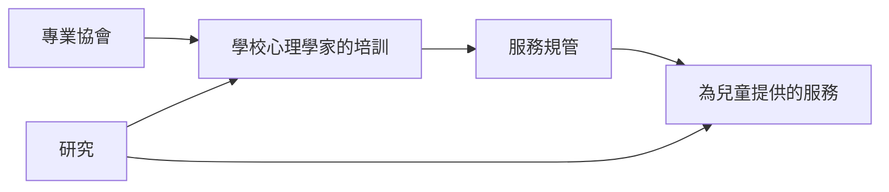

## 這是什麼

國際學校心理學研究學校心理學在不同國家如何運作。它關心學校心理學家是誰、如何受訓、服務如何受規管。它也關心各國專業人員如何合作。

國際學校心理學協會（International School Psychology Association，ISPA）是這種合作的平台之一。協會網站指出，1970 年代初，一群來自世界各地的學校心理學家組成了 International School Psychology Committee。委員會的目標是促進學校心理學家與教育心理學家的全球合作。ISPA 於 1982 年成立，首任會長是 Anders Poulsen [N-T4-1]。

## 為什麼重要

每個國家的孩子都要上學。各國的學校心理學家，卻在不同的法律、經費和培訓制度下工作。跨國比較，能讓每個國家更清楚看見自己的制度。新成立的培訓課程，也可以參考較成熟的課程。

一項 1992 年的調查，研究已發展與發展中國家的學校心理學。作者發現，各地對學校心理學家的角色與功能，看法相近。他們也發現，越發達的國家，對專業精神的期望越高 [N-T4-2]。

## Oakland 教授的貢獻

1. **ISPA 領導工作。** Oakland 教授曾擔任 ISPA 會長。《The School Psychologist》上的一篇悼文指出，他的任期是 1995 至 1997 年 [S12]。
2. **一本手冊。** Jimerson、Oakland 與 Farrell 主編《The Handbook of International School Psychology》（SAGE，2007）[S19]。
3. **國際研究。** Oakland 與 Cunningham（1992）邀請學校心理學專家，回答已發展與發展中國家學校心理學的現況。調查涵蓋六個議題：功能、特徵、培訓、服務規管、研究的重要性，以及預測的未來趨勢 [N-T4-2]。
4. **專業的優先事項。** 同一期專刊中，Oakland 整理了其他作者對調查數據的回應。主要主題包括：在專業一致性與多元性之間取得平衡、維持對研究的承諾，以及建立國家與國際層級的專業協會。主題也包括成立國際學校心理學研究機構，以及進行後續的國際研究 [N-T4-3]。
5. **一段歷史。** Oakland（1993）撰寫了《A brief history of international school psychology》。見「延伸閱讀」。
6. **專業培訓。** 2014 年，Oakland 與 Hatzichristou 整理了數個國家的培訓課程資料。他們指出，國家、區域和國際協會需要更強的領導，才能抵銷外部控制對這個專業的影響 [N-T4-4]。同一專刊中，Oakland 的後記列出五個議題。ISPA 若檢討培訓指引，就要考慮這五個議題 [N-T4-5]。

## 核心概念

- **規管。** 1992 年調查指出，大學、聯邦機構，以及心理學與教育界的專業協會，共同規管學校心理學 [N-T4-2]。
- **培訓。** 指一個國家如何培訓學校心理學家。它是調查的六個議題之一 [N-T4-2]。
- **一致性與多元性。** 一個專業需要共同標準，也需要容納本地需要。Oakland（1992）把這種平衡列為主要主題 [N-T4-3]。
- **專業協會。** 國家與國際協會支持這個專業及其培訓 [N-T4-3] [N-T4-4]。

## 實務應用

這些概念對學生、培訓者和學校心理學家都有用。

1. 把你自己的培訓路徑，與另一個國家比較。問一問：兩地各由誰規管這個專業？
2. 閱讀外國研究時，想一想：當地的法律、經費和文化，如何影響服務？
3. 同時留意共通之處與本地差異。1992 年調查指出各地對角色的看法相近，也指出高 GNP 與低 GNP 國家之間常有顯著差異 [N-T4-2]。
4. 加入或追蹤專業協會。協會提供培訓、資源，也讓你認識海外同行。

## 自我檢核

1. 關於學校心理學家的角色與功能，哪一項符合 1992 年調查的發現？
   - A. 每個國家的看法都很不同。
   - B. 世界各地的看法相近。
   - C. 只有已發展國家界定這些角色。
   - D. 這些角色與教師的角色相同。

   **Answer:** B。調查摘要指出，世界各地對角色與功能的概念相近。

2. 根據調查，哪類國家對專業精神的期望較高？
   - A. 較發達的國家。
   - B. 較不發達的國家。
   - C. 沒有大學的國家。
   - D. 沒有協會的國家。

   **Answer:** A。摘要指出，較發達的國家期望較高。

3. 下列哪一項是 Oakland 1992 年討論優先事項時的主題？
   - A. 把研究從培訓中刪除。
   - B. 各國使用同一個固定模式。
   - C. 在專業一致性與多元性之間取得平衡。
   - D. 取消所有國家級協會。

   **Answer:** C。文章把這種平衡列為主要主題。

4. 《The School Psychologist》的悼文，列出 Oakland 教授擔任 ISPA 會長的年份是哪一段？
   - A. 1982 至 1984 年。
   - B. 1990 至 1992 年。
   - C. 1995 至 1997 年。
   - D. 2005 至 2007 年。

   **Answer:** C。悼文寫明是 1995 至 1997 年。

## 延伸閱讀

- Jimerson, S. R., Oakland, T. D., & Farrell, P. T. (Eds.). (2007). *The handbook of international school psychology*. SAGE Publications. https://doi.org/10.4135/9781412976138
- Oakland, T. (1993). A brief history of international school psychology. *Journal of School Psychology, 31*(1), 109-122. https://doi.org/10.1016/0022-4405(93)90024-d
- Oakland, T. D. (1992). Formulating priorities for international school psychology toward the turn of the twentieth century. *School Psychology International, 13*(2), 171-177. https://doi.org/10.1177/0143034392132008
- Oakland, T. D., & Cunningham, J. L. (1992). A survey of school psychology in developed and developing countries. *School Psychology International, 13*(2), 99-129. https://doi.org/10.1177/0143034392132001
- Oakland, T. (2014). An epilogue: Issues and implications for incorporating multicultural issues in the International School Psychology Association's professional preparation guidelines. *International Journal of School & Educational Psychology, 2*(3), 231-234. https://doi.org/10.1080/21683603.2014.934614
- Oakland, T., & Hatzichristou, C. (2014). Professional preparation in school psychology: A summary of information from programs in seven countries. *International Journal of School & Educational Psychology, 2*(3), 223-230. https://doi.org/10.1080/21683603.2014.934638

*本頁內容用於教育，不能取代專業意見。*
