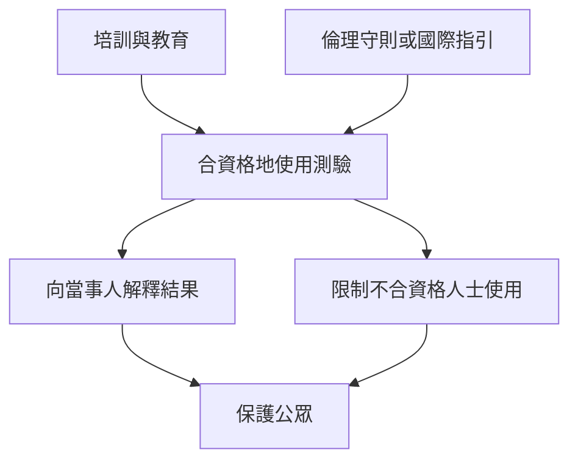

## 這是什麼

評估倫理，指心理學家和其他專業人員如何審慎地使用測驗。倫理守則列明一個專業期望成員做到的行為。Leach 與 Oakland 指出，這類守則的設計目的，是透過訂明專業人員應有的行為來保護公眾 [N-T5-3]。

專業精神的範圍更闊。它包括培訓、執業標準，以及專業所承擔的責任。本單元兩者都談，只引用 Oakland 教授已發表的著作。

## 為什麼重要

不少專業人員會為兒童和青少年進行測驗。一項調查發現，最常使用測驗的專業群體包括學校或教育心理學家、教師、輔導員，以及臨床和一般心理學家 [N-T5-1]。每一個群體都需要清晰的標準。

倫理守則並非各地都有。一項針對各國心理學會守則的檢視發現，約三分之一受調查國家的守則沒有談到測驗使用 [N-T5-3]。因此，心理學家可能在沒有成文規則的地方工作。Oakland 日後與 Leach 的研究，處理的正是這個問題 [N-T5-4]。

## Oakland 教授的貢獻

1. **學校心理學中的專業精神。** 1986 年，Oakland 在《Professional School Psychology》發表兩篇文章：〈Professionalism within school psychology〉和〈Further thoughts on professionalism in school psychology〉。見「延伸閱讀」。
2. **誰使用測驗，又如何學會。** Oakland 與 Hu（1991）在一項國際調查中，檢視了使用測驗的專業群體。他們報告，多數專業人員透過課程學習測驗。他們也報告，自覺使用測驗是否稱職，與大專以上的受教育年數有顯著相關 [N-T5-1]。
3. **國際協會的倫理守則。** Oakland、Goldman 與 Bischoff 於 1997 年發表《Code of Ethics of the International School Psychology Association》。守則由 ISPA 的 Standards and Practices Committee 擬訂，並於 1990 年 8 月獲 ISPA 全體大會通過。內容涵蓋專業責任、保密、專業成長、專業限制、專業關係、評估與研究 [N-T5-2]。
4. **學校心理學家的測驗使用。** Oakland（1997）回顧了兒童和青少年測驗的現行使用情況，對象主要是學校或教育心理學家。他討論了這個專業的地位、測驗使用的傳統目的與常見問題，以及新興趨勢 [N-T5-5]。
5. **各國的倫理守則。** Leach 與 Oakland（2007）把多國倫理守則中的測驗標準，與 2002 年 APA 守則比較。最常見的標準，是要求心理學家解釋結果、妥善使用測驗，以及限制不合資格人士使用測驗。談到測驗編製的標準，以及限制使用過時測驗的標準，則很少見 [N-T5-3]。
6. **標準不明確時。** Leach 與 Oakland（2010）討論了在沒有倫理守則的國家工作的心理學家。他們指出幾項須留意的條件：東道國的道德價值、法律與行政政策，以及國際機構和協會的倫理守則與政策。他們也提出八項指引 [N-T5-4]。
7. **培訓指引。** 2014 年的後記中，Oakland 列出五個議題。ISPA 若檢討培訓指引，就要考慮這五個議題 [N-T4-5]。

## 核心概念

- **倫理守則。** 一套成文的行為期望，目的是保護公眾 [N-T5-3]。
- **合資格使用。** 守則常要求心理學家限制不合資格人士使用測驗 [N-T5-3]。
- **解釋結果。** 守則常要求心理學家解釋結果 [N-T5-3]。
- **培訓與稱職程度。** 1991 年調查中，大專以上受教育年數越多，自覺使用測驗越稱職 [N-T5-1]。
- **東道國的脈絡。** 沒有守則時，心理學家要考慮當地價值觀、法律、政策和國際指引 [N-T5-4]。

## 實務應用

以下問題來自上述研究。它們不能取代適用於你的守則。

1. 我的工作受哪一份倫理守則規範？如果沒有，當地法律、政策和國際指引怎樣說 [N-T5-4]？
2. 我為這項評估接受過訓練嗎？
3. 我能用淺白的話，向有需要的人解釋結果嗎 [N-T5-3]？
4. 還有誰能接觸測驗材料？我需要把使用限於合資格人士嗎 [N-T5-3]？
5. 這個測驗還是最新的嗎？Leach 與 Oakland 發現，限制過時測驗的標準很少見，所以要自己檢查 [N-T5-3]。

## 自我檢核

1. 在 Leach 與 Oakland（2007）檢視的倫理守則中，哪一類標準最常出現？
   - A. 設計新測驗的標準。
   - B. 要求解釋結果的標準。
   - C. 測驗價格的標準。
   - D. 禁止一切測驗使用的標準。

   **Answer:** B。摘要指出，解釋結果、妥善使用測驗，以及限制不合資格人士使用，是最常見的標準。

2. 1991 年調查發現，多數專業人員如何學會測驗？
   - A. 主要透過課程。
   - B. 主要透過報紙。
   - C. 主要只靠出版社。
   - D. 主要靠反覆試錯。

   **Answer:** A。摘要指出，多數專業人員透過課程學習測驗。

3. 一位心理學家搬到沒有倫理守則的國家工作。Leach 與 Oakland（2010）建議他了解什麼？
   - A. 只了解原居地的規則。
   - B. 什麼都不用，因為沒有規則適用。
   - C. 東道國的道德價值、法律與政策，以及國際守則與政策。
   - D. 只了解最大的測驗出版社的規則。

   **Answer:** C。摘要列出了這些條件。

4. 《Code of Ethics of the International School Psychology Association》由哪個單位擬訂？
   - A. ISPA 的 Standards and Practices Committee。
   - B. 某國的教育部。
   - C. 某測驗出版社。
   - D. 某大學學系。

   **Answer:** A。摘要指出，守則由 Standards and Practices Committee 擬訂。

## 延伸閱讀

- Leach, M. M., & Oakland, T. (2007). Ethics standards impacting test development and use: A review of 31 ethics codes impacting practices in 35 countries. *International Journal of Testing, 7*(1), 71-88. https://doi.org/10.1080/15305050709336859
- Leach, M. M., & Oakland, T. (2010). Displaying ethical behaviors by psychologists when standards are unclear. *Ethics & Behavior, 20*(3-4), 197-206. https://doi.org/10.1080/10508421003798893
- Oakland, T. (1997). Test use among school psychologists: Past, current, and emerging practices. *European Journal of Psychological Assessment, 13*(1), 2-9. https://doi.org/10.1027/1015-5759.13.1.2
- Oakland, T., & Hu, S. (1991). Professionals who administer tests with children and youth: An international survey. *Journal of Psychoeducational Assessment, 9*(2), 108-120. https://doi.org/10.1177/073428299100900201
- Oakland, T., Goldman, S., & Bischoff, H. (1997). Code of ethics of the International School Psychology Association. *School Psychology International, 18*(4), 291-298. https://doi.org/10.1177/0143034397184001
- Oakland, T. D. (1986). Professionalism within school psychology. *Professional School Psychology, 1*(1), 9-27. https://doi.org/10.1037/h0090496
- Oakland, T. D. (1986). Further thoughts on professionalism in school psychology. *Professional School Psychology, 1*(1), 47-49. https://doi.org/10.1037/h0090495

*本頁內容用於教育，不能取代專業意見。*
