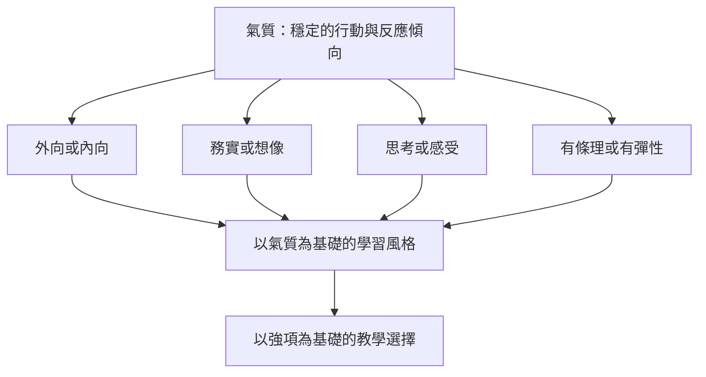

## 這是什麼

氣質（temperament）描述一個人慣常的行動與反應方式。學界通常視氣質為具風格、相對穩定的特質。氣質包含內在傾向，使人對他人、事件和其他刺激作出大致可預期的反應 [N-T2-8]。

學習風格把這些傾向連到學校情境。Oakland 與 Joyce（2004）說明，氣質風格會影響教學風格和學習風格 [N-T2-2]。

Oakland 與同事用八種基本風格描述 8 至 17 歲的兒童。八種風格組成四組對偶 [N-T2-3]：

1. 外向或內向。
2. 務實或想像。
3. 思考或感受。
4. 有條理或有彈性。

這些對偶描述的是偏好 [N-T2-1]。

## 為什麼重要

了解兒童的氣質，有助成人理解行為的來源。也有助理解兒童在家裡和學校表現的一般態度 [N-T2-8]。

教師可以運用這些知識。Oakland 與 Joyce（2004）鼓勵教師讓學生有機會發揮強項、克服弱點。他們也鼓勵教師促進正向行為，幫助學生認識自己和他人，並找出職業興趣 [N-T2-2]。

## Oakland 教授的貢獻

Oakland、Horton 與 Glutting 於 1996 年出版《Student Styles Questionnaire》（SSQ）。Buros Center for Testing 記載它的用途：用來偵測學生在偏好、氣質與個人風格上的個別差異 [N-T2-1]。

後續研究為 SSQ 建立了證據基礎。以下舉四例。

1. **理論基礎。** SSQ 以 Jung 的氣質理論為基礎，並參考 Myers 與 Briggs 的擴充 [N-T2-4]。
2. **同一國家內，不同族群是否公平。** Stafford 與 Oakland（1996）研究非裔、拉丁裔和歐裔美國學生。他們發現三個族群的因素結構高度相似。比較居住在 New York 和 Texas 的拉丁裔學生時，相似程度較弱 [N-T2-6]。比較非裔與歐裔學生時，有 25% 的題目出現差異 [N-T2-9]。
3. **不同國家之間，是否公平。** Benson、Oakland 與 Shermis（2008）檢驗四組對偶的模型。這個模型對澳洲、中國、哥斯大黎加、菲律賓、美國和辛巴威的樣本適配度極佳，對加薩（巴勒斯坦）和奈及利亞的樣本則只有中等適配度。作者認為這部分支持以下看法：這個結構超越語言與文化的差異 [N-T2-4]。
4. **群體比較。** 在一項資優與非資優學生的研究中，兩組學生在三組對偶上差異不大。資優學生較偏好想像風格，非資優學生較偏好務實風格 [N-T2-5]。在一項中國與美國的比較中，中國兒童較常偏好務實、思考和有條理的風格。作者指出，這可能反映集體主義或個人主義社會所重視的價值 [N-T2-7]。

## 核心概念

- **氣質。** 具風格、相對穩定的行動與反應傾向 [N-T2-8]。
- **雙極風格對偶。** 同一條連續線上的兩個相反風格。四組對偶構成整個模型 [N-T2-3]。
- **偏好，不是能力。** SSQ 看的是偏好、氣質與個人風格 [N-T2-1]。
- **測量不變性（invariance）。** 測驗的分數在各國意義相同，就具有跨國不變性。Benson、Oakland 與 Shermis（2008）為 SSQ 檢驗這一點 [N-T2-4]。
- **群體差異，不是個人規則。** 兩個群體之間的差距，只說明群體的情況。它不能預測某位兒童會怎麼做 [N-T2-5]。

## 實務應用

1. **從強項開始。** 讓學生有機會發揮強項，再支持他們感到吃力的地方 [N-T2-2]。
2. **談談彼此的差異。** 幫助學生認識自己和他人。Oakland 與 Joyce（2004）把這一點列為教師的目標之一 [N-T2-2]。
3. **把眼光放到課堂之外。** 風格資訊也可以指出職業興趣 [N-T2-2]。
4. **留意適用年齡。** SSQ 是針對 8 至 17 歲學生的氣質測量工具 [N-T2-6]。
5. **透過合格專業人員使用測驗。** 本站不刊登題目、計分方法或常模，這些屬於出版社。請參閱本站的 SSQ 簡介頁。
6. **比較之前，先檢查文化。** 一個國家的結果不會自動適用於另一個國家。跨國證據對部分樣本較強，對其他樣本較弱 [N-T2-4]。

## 自我檢核

1. 在 Oakland 針對 8 至 17 歲兒童的模型中，有幾組雙極對偶描述氣質？

   A. 兩組
   B. 四組
   C. 八組
   D. 十六組

   **Answer:** B。理由：八種基本風格組成四組雙極對偶 [N-T2-3]。

2. 一位教師得知，資優學生平均而言比非資優學生更偏好想像風格。最合理的結論是哪一項？

   A. 每位資優學生都偏好想像風格。
   B. 想像風格導致資優。
   C. 這個結果描述的是群體，所以每位學生仍需要個別關注。
   D. 務實風格是一種弱點。

   **Answer:** C。理由：群體差異不能預測個別兒童的風格 [N-T2-5]。

3. 以下哪一項最能說明 SSQ 看的內容？

   A. 智商
   B. 偏好、氣質與個人風格
   C. 閱讀程度
   D. 日常生活中的適應行為

   **Answer:** B。理由：Buros 的條目寫明了這個用途 [N-T2-1]。

4. 研究者為什麼要在多個國家檢驗同一個氣質測量工具？

   A. 確認分數在不同文化中意義相同。
   B. 把測驗縮短。
   C. 省去效度證據。
   D. 把各國從最好排到最差。

   **Answer:** A。理由：這就是跨國不變性的問題，Benson、Oakland 與 Shermis（2008）探討過 [N-T2-4]。

## 延伸閱讀

- Benson, N., Oakland, T., & Shermis, M. (2008). Cross-national invariance of children's temperament. *Journal of Psychoeducational Assessment, 27*(1), 3-16. https://doi.org/10.1177/0734282908318563
- Calluen, C., & Oakland, T. (2014). If you do not know the child's temperament you do not know the child. *Estudos de Psicologia (Campinas), 31*(1), 3-14. https://doi.org/10.1590/0103-166x2014000100001
- Oakland, T., & Joyce, D. (2004). Temperament-based learning styles and school-based applications. *Canadian Journal of School Psychology, 19*(1-2), 59-74. https://doi.org/10.1177/082957350401900103
- Oakland, T., Joyce, D. D., Horton, C., & Glutting, J. (2000). Temperament-based learning styles of identified gifted and nongifted students. *Gifted Child Quarterly, 44*(3), 183-189. https://doi.org/10.1177/001698620004400304
- Stafford, M. E., & Oakland, T. D. (1996). Validity of temperament constructs using the Student Styles Questionnaire: Comparisons for three racial-ethnic groups. *Journal of Psychoeducational Assessment, 14*(2), 109-120. https://doi.org/10.1177/073428299601400202

*本頁內容用於教育，不能取代專業評估。*
