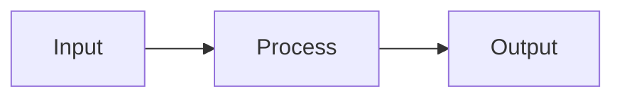

## What it is

This is a placeholder. It carries no real teaching content.

## Core ideas

## Self-check

1. Which letter comes first in this demo question?

   - A. A
   - B. B
   - C. C
   - D. D

   **Answer:** A

   The first letter is A. This explanation shows after answering.

2. Which option is the last one?

   - A. First
   - B. Second
   - C. Third
   - D. Fourth

   **Answer:** D

   D is the fourth and last option.

This unit is a layout test and is not for teaching.
