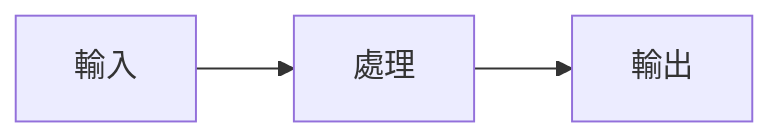

## 這是什麼

這是示意單元，沒有真正的教學內容。

## 核心概念

## 自我檢核

1. 這個示意題目裡，哪個字母排第一？

   - A. A
   - B. B
   - C. C
   - D. D

   **答案：** A

   第一個字母是 A。作答後才顯示這段解釋。

2. 哪個選項是最後一個？

   - A. 第一
   - B. 第二
   - C. 第三
   - D. 第四

   **答案：** D

   D 是第四個，也是最後一個選項。

這個單元只是版面測試，不用於教學。
